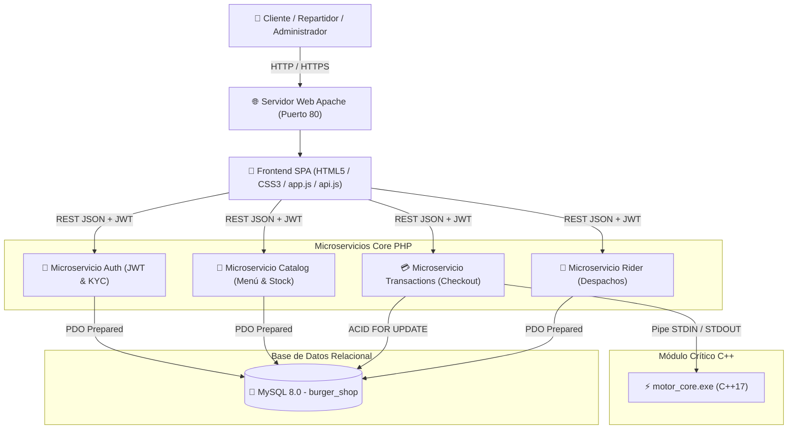
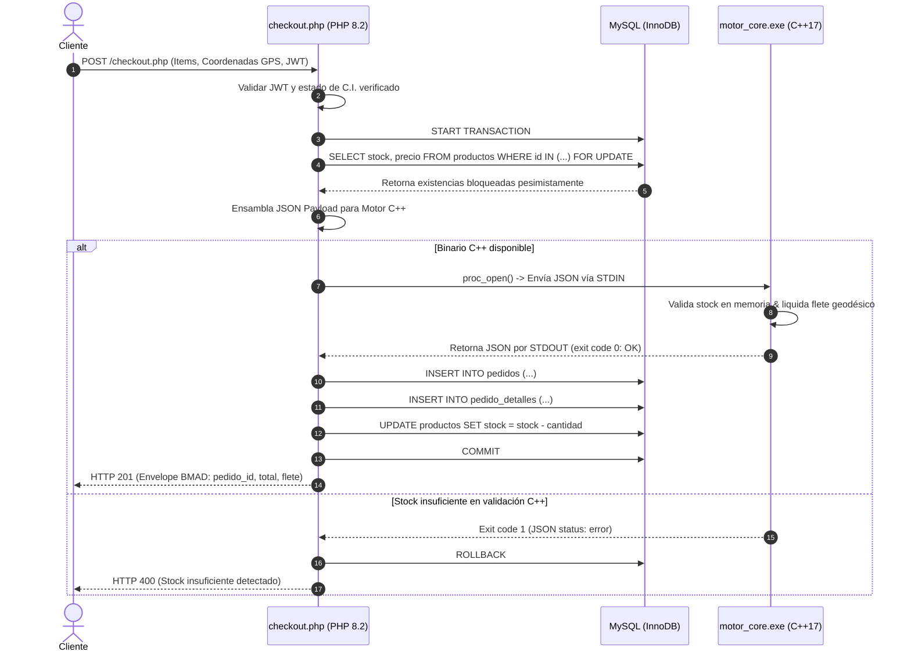
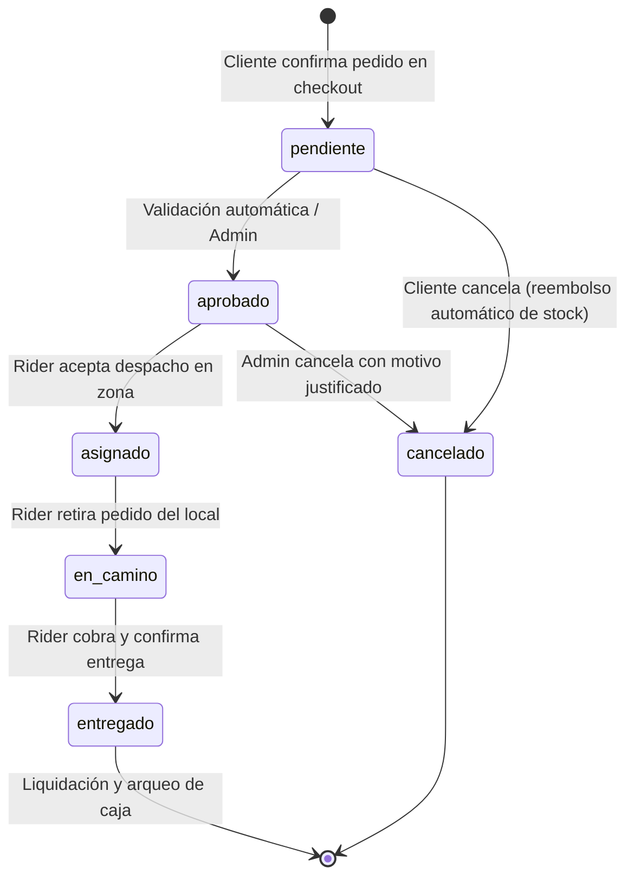

# 🍔 Burger 24/7 &mdash; Plataforma E-Commerce y Logística en Tiempo Real

[](https://www.php.net/)
[](https://www.mysql.com/)
[](https://httpd.apache.org/)
[](https://isocpp.org/)
[](https://leafletjs.com/)
[]()
[]()

> **Sistema integral de comercio electrónico de comida rápida y despacho continuo (24 horas, 7 días a la semana) con arquitectura de microservicios, geolocalización GPS en vivo y monitoreo de flota en tiempo real, listo para despliegue en servidor web.**

---

## 📑 Tabla de Contenido General

1. [🚀 GUÍA DE DESPLIEGUE Y PUESTA EN MARCHA MANUAL (Para Desarrolladores / Informáticos)](#-guía-de-despliegue-y-puesta-en-marcha-manual)
   - [📋 Requisitos del Sistema](#-1-requisitos-del-sistema-stack-de-software)
   - [🛠️ Paso a Paso: Aprovisionamiento y Despliegue Manual](#-2-paso-a-paso-aprovisionamiento-y-despliegue-manual)
   - [💻 Opciones de Levantamiento del Servidor Web](#-3-opciones-de-levantamiento-del-servidor-web)
   - [🔍 Diagnóstico y Verificación de Salud](#-4-diagnóstico-y-verificación-de-salud-check_deploy)
   - [🔑 Cuentas Semilla y Credenciales Demo](#-5-cuentas-semilla-y-credenciales-demo-para-pruebas)
2. [¿Qué es Burger 24/7? (Visión General)](#-1-qué-es-burger-247)
3. [🏛️ Especificación Técnica y Arquitectura de Despliegue](#-2-especificación-técnica-y-arquitectura-de-despliegue)
4. [📐 Diagramas del Sistema y Flujos Transaccionales](#-3-diagramas-del-sistema-y-flujos-transaccionales)
5. [🛡️ Regla de Oro y Estándar BMAD](#-4-regla-de-oro-y-estándar-bmad)
6. [📡 Catálogo Completo de APIs REST](#-5-catálogo-completo-de-apis-rest)
7. [⚡ Módulo Crítico de Rendimiento en C++](#-6-módulo-crítico-de-rendimiento-en-c)
8. [🗄️ Modelo Relacional de Base de Datos (Diccionario 3FN)](#-7-modelo-relacional-de-base-de-datos-diccionario-3fn)
9. [⚙️ Despliegue en Servidor Web Apache y MySQL (XAMPP / Producción)](#-9-despliegue-en-servidor-web-apache-y-mysql-xampp--producción)
10. [🔑 Cuentas de Acceso Preconfiguradas (Credenciales Demo)](#-10-cuentas-de-acceso-preconfiguradas-credenciales-demo)
11. [🔍 Diagnóstico Automatizado del Sistema (`check_deploy`)](#-11-diagnóstico-automatizado-del-sistema-check_deploy)
12. [📂 Estructura del Repositorio](#-12-estructura-del-repositorio)
13. [❓ Preguntas Frecuentes y Solución de Problemas](#-13-preguntas-frecuentes-y-solución-de-problemas)

---

## 🚀 GUÍA DE DESPLIEGUE Y PUESTA EN MARCHA MANUAL

> **Guía para Administradores, Desarrolladores e Informáticos**  
> Todo el aprovisionamiento, compilación de módulos binarios, migración de esquemas SQL y encendido de servicios se realiza de forma **100% manual y reproducible** mediante herramientas estándar de línea de comandos (CLI).

---

### 📋 1. Requisitos del Sistema (Stack de Software)

Asegúrate de contar con las siguientes herramientas instaladas y accesibles en tu entorno:

| Componente | Versión Mínima | Rol en la Arquitectura | Comprobación CLI |
| :--- | :--- | :--- | :--- |
| **PHP** | 8.2+ | Backend de Microservicios (`pdo`, `pdo_mysql`, `curl`, `mbstring`, `fileinfo`) | `php -v` |
| **MySQL / MariaDB** | 8.0+ / 10.4+ | Persistencia Relacional InnoDB (Puerto 3306) | `mysql --version` |
| **GCC / G++ (MinGW-w64)** | 11.0+ (C++17) | Compilador nativo del motor algorítmico y logístico | `g++ --version` |
| **Servidor HTTP** | Apache 2.4+ / PHP Built-in | Servidor Web de aplicaciones y estáticos | `httpd -v` o `php -S` |

---

### 🛠️ 2. Paso a Paso: Aprovisionamiento y Despliegue Manual

#### 🔹 Paso 1: Configurar Variables de Entorno (`.env`)
Clona o copia el archivo de plantilla `.env.example` en la raíz del proyecto:

```bash
# En Windows (PowerShell / CMD)
copy .env.example .env

# En Linux / macOS
cp .env.example .env
```

Verifica o ajusta los parámetros de base de datos y la llave criptográfica JWT en el archivo `.env`:
```ini
DB_HOST=127.0.0.1
DB_PORT=3306
DB_NAME=burger_shop
DB_USER=root
DB_PASS=
DB_CHARSET=utf8mb4
JWT_SECRET=08aef182c3aad21602385a97c86a1cdb11811217df149b666ab353a1e708c2e0
ALLOWED_ORIGINS=http://localhost,http://127.0.0.1,http://localhost:80,http://localhost:8000
```

#### 🔹 Paso 2: Crear Directorios de Almacenamiento (Uploads y KYC)
El sistema requiere carpetas con permisos de escritura para almacenar fotos de carnet (C.I.), expedientes vehiculares y comprobantes de transferencias QR:

```bash
# Crear carpetas de almacenamiento seguras
mkdir -p uploads/ci uploads/docs uploads/qr
mkdir -p microservices/Auth/uploads/ci microservices/Auth/uploads/docs microservices/Auth/uploads/qr
```
*(Nota: Cada carpeta cuenta con directivas de blindaje `.htaccess` que bloquean la ejecución de scripts arbitrarios en Apache).*

#### 🔹 Paso 3: Aprovisionar y Migrar la Base de Datos MySQL
Asegúrate de que el daemon de MySQL esté activo en el puerto 3306.

**Método A (Recomendado - Migración Automatizada en PHP):**
```bash
php migrate.php
```
*Si requieres reiniciar las tablas y volver a sembrar los datos demo desde cero:*
```bash
php migrate.php --fresh
```

**Método B (Importación Directa mediante CLI de MySQL):**
```bash
# 1. Crear base de datos
mysql -u root -p -e "CREATE DATABASE IF NOT EXISTS burger_shop CHARACTER SET utf8mb4 COLLATE utf8mb4_unicode_ci;"

# 2. Importar tablas, índices relacionales y usuarios semilla
mysql --default-character-set=utf8mb4 -u root -p burger_shop < install_db.sql

# 3. Normalizar codificación UTF-8 en el catálogo
php microservices/Catalog/clean_data_charset.php
```

#### 🔹 Paso 4: Compilar Manualmente los Módulos Críticos en C++ (C++17)
El sistema delega el cálculo de alta concurrencia (latencia $<150\,\mu\text{s}$) y el algoritmo de tarifas geodésicas Haversine al motor binario compilado.

Compila el motor principal con optimización `-O3`:
```bash
# Compilar motor core de transacciones y cálculo de stock
g++ -O3 -std=c++17 cpp/motor_core.cpp -o cpp/motor_core.exe

# (Opcional) Compilar calculador de logística auxiliar
g++ -O3 microservices/Logistics/calculator.cpp -o microservices/Logistics/calculator.exe
```

---

### 💻 3. Opciones de Levantamiento del Servidor Web

#### 🌐 Opción A: Servidor Embebido de PHP (Ideal para Desarrollo / Testing Inmediato)
Desde la raíz del repositorio, ejecuta:
```bash
php -S localhost:8000
```
Abre tu navegador en:  
👉 **`http://localhost:8000/`**

> **Ventajas:**
> * Cero dependencias de servidores externos.
> * Sirve los estáticos del frontend (`index.html`, `app.js`, `style.css`) y despacha las peticiones a los microservicios PHP (`/microservices/*`).
> * Para detener el servidor, basta con presionar `Ctrl + C`.

#### 🏛️ Opción B: Despliegue en Apache / XAMPP
1. Si usas XAMPP en Windows, crea un Directory Junction o enlace simbólico hacia `htdocs`:
   ```cmd
   mklink /J "C:\xampp\htdocs\Bebidas-E-Commerce" "D:\Bebidas-E-Commerce"
   ```
2. Inicia los módulos **Apache** y **MySQL** desde el panel de XAMPP o mediante servicios del sistema operativo:
   ```powershell
   net start Apache2.4
   net start MySQL
   ```
3. Abre tu navegador en:  
   👉 **`http://localhost/Bebidas-E-Commerce/`**

---

### 🔍 4. Diagnóstico y Verificación de Salud (`check_deploy`)
Para corroborar que todas las extensiones, conexión a MySQL, permisos de escritura y el binario C++ estén al 100%:

```bash
# Diagnóstico por línea de comandos (CLI)
php check_deploy.php

# O en Windows:
.\check_deploy.bat
```
También puedes auditarlo vía interfaz web visitando:  
👉 `http://localhost:8000/check_deploy.php` *(o `http://localhost/Bebidas-E-Commerce/check_deploy.php`)*.

---

### 🔑 5. Cuentas Semilla y Credenciales Demo para Pruebas

En la pantalla de inicio, en la esquina inferior izquierda, cuentas con el botón interactivo **`🔑 Cuentas Demo (Abrir ▴)`** para alternar de sesión en un solo clic:

| Rol / Tipo | Nombre del Personaje | Correo Electrónico | Contraseña | Estado Oficial | Documentación / Vehículo |
| :--- | :--- | :--- | :--- | :--- | :--- |
| **Cliente Habilitado** | Carlos Pérez | `carlos@mail.com` | `carlos` | ✅ Verificado | C.I. Oficial vigente (La Paz) |
| **Cliente Habilitado** | Andrea Morales | `andrea@mail.com` | `andrea` | ✅ Verificado | C.I. Oficial vigente (Cochabamba) |
| **Cliente Habilitado** | Gonzalo Salinas | `gonzalo@mail.com` | `gonzalo` | ✅ Verificado | C.I. Oficial vigente (Santa Cruz) |
| **Cliente Pendiente** | María López | `maria@mail.com` | `maria` | ⏳ Pendiente | En revisión por el administrador |
| **Cliente Pendiente** | Diego Quiroga | `diego@mail.com` | `diego` | ⏳ Pendiente | En revisión por el administrador |
| **Cliente Rechazado** | Roberto Flores | `roberto@mail.com` | `roberto` | ❌ Denegado | Motivo: C.I. borroso e ilegible |
| **Rider Habilitado** | Pedro Gómez | `pedro@mail.com` | `pedro` | ✅ Aprobado | Honda Wave 110cc (Placa: 4829-ABC) |
| **Rider Habilitado** | Alejandro Ríos | `alejandro@mail.com` | `alejandro` | ✅ Aprobado | Yamaha FZ 150cc (Placa: 5192-XYZ) |
| **Rider Pendiente** | Juan Rodríguez | `juan@mail.com` | `juan` | ⏳ Pendiente | Bajaj Pulsar 160 (Placa: 6281-MNP) |
| **Rider Rechazado** | Marcos Vargas | `marcos@mail.com` | `marcos` | ❌ Denegado | Motivo: Licencia no registrada en SEGIP |
| **Administrador** | Admin Central | `admin@mail.com` | `admin` | 👑 Habilitado | Acceso total a finanzas, catálogo y flota |

---

## 📌 1. ¿Qué es Burger 24/7?

**Burger 24/7** es una solución tecnológica completa para digitalizar y automatizar el ciclo de venta, cobro, preparación y despacho de alimentos en horario ininterrumpido. El sistema implementa un entorno **multi-actor** con tres paneles especializados:

* 👤 **Panel de Cliente:** Catálogo dinámico organizado por categorías (Hamburguesas, Combos, Bebidas, Acompañamientos), carrito reactivo, selección visual del punto de entrega mediante un mapa interactivo (GPS con Leaflet), pasarela de pago (QR digital o contraentrega en efectivo), generación de **Recibo Digital Imprimible** y seguimiento en tiempo real.
* 🛵 **Panel de Repartidor (Rider):** Notificación de órdenes en zona, cálculo instantáneo de fletes con el motor nativo en C++, trazado de rutas viales sobre mapas oscuros CartoDB, confirmación de entregas y arqueo de caja de recaudación.
* 👑 **Panel de Administrador (Super Usuario):** Gestión integral del menú e inventario (CRUD atómico de productos), monitoreo geográfico en vivo de la flota de repartidores en tiempo real, aprobación/rechazo de expedientes de identidad (C.I.) y conductores, y reportes financieros de ventas.

---

## 🏛️ 2. Especificación Técnica y Arquitectura de Despliegue

En estricta conformidad con la especificación del sistema ([`SPEC.md`](SPEC.md)), la plataforma opera de forma autónoma desplegada directamente sobre el servidor web:

```text
┌────────────────────────────────────────────────────────────────────────┐
│                   ARQUITECTURA DE PRODUCCIÓN WEB                       │
├───────────────────┬────────────────────────────────────────────────────┤
│ COMPONENTE        │ ROL TÉCNICO EN EL SISTEMA                          │
├───────────────────┼────────────────────────────────────────────────────┤
│ PHP 8.2+ (PDO)    │ Microservicios Core transaccionales (Auth, Catalog,│
│                   │ Transactions, Rider), emisión JWT, PDO y ACID.     │
├───────────────────┼────────────────────────────────────────────────────┤
│ C++ (C++17)       │ Motor Core compilado nativo (cpp/motor_core.exe)   │
│                   │ de ultra-baja latencia (<150 µs): tarifas y stock. │
├───────────────────┼────────────────────────────────────────────────────┤
│ JS (ES6+) / HTML5 │ Single Page Application (SPA) Glassmorphism, mapas │
│ / CSS3            │ interactivos Leaflet.js y cliente desacoplado.     │
├───────────────────┼────────────────────────────────────────────────────┤
│ SQL / MySQL 8.0+  │ Motor relacional InnoDB en 3FN, bloqueos pesimistas│
│                   │ (SELECT FOR UPDATE) y trazabilidad inmutable.      │
├───────────────────┼────────────────────────────────────────────────────┤
│ Apache 2.4+       │ Servidor HTTP de producción con mod_rewrite y      │
│                   │ blindaje perimetral .htaccess anti-RCE.            │
└───────────────────┴────────────────────────────────────────────────────┘
```

### Justificación Técnica de los Componentes:

1. **PHP (8.2+ con extensión PDO):**  
   Gestiona la totalidad de la capa de microservicios RESTful (`Auth`, `Catalog`, `Transactions`, `Rider`). Provee autenticación sin estado mediante tokens JWT criptográficamente firmados con HMAC-SHA256, conexión Singleton y sentencias preparadas contra MySQL para neutralizar vulnerabilidades SQL Injection.
2. **C++ (C++17 Estándar ANSI):**  
   Módulo de rendimiento crítico ([`cpp/motor_core.cpp`](cpp/motor_core.cpp) $\rightarrow$ [`cpp/motor_core.exe`](cpp/motor_core.exe)). Desacopla de PHP las operaciones algorítmicas de alta intensidad: cálculo geodésico Haversine, cálculo determinista de tarifas de flete y comprobación atómica de inventario bajo alta concurrencia transaccional, con latencia media inferior a **150 microsegundos**.
3. **JavaScript (ES6+), HTML5 Semántico y CSS3 Moderno:**  
   Single Page Application (SPA) reactiva con estética Glassmorphism, animaciones fluidas y mapas interactivos mediante Leaflet.js. La capa de red ([`api.js`](api.js)) maneja peticiones asíncronas hacia el servidor web e inyecta automáticamente la cabecera `Authorization: Bearer <token>`.
4. **MySQL 8.0+ / MariaDB (Motor InnoDB):**  
   Persistencia relacional normalizada en Tercera Forma Normal (3FN). Aplica bloqueos pesimistas (`SELECT ... FOR UPDATE`) en transacciones atómicas de checkout para evitar condiciones de carrera (*race conditions*) en compras simultáneas.
5. **Apache 2.4+ (Servidor Web):**  
   Encargado del enrutamiento HTTP, negociación de cabeceras CORS, control de acceso y protección perimetral mediante directivas `.htaccess` en los directorios de subida (`uploads/`).

---

## 📐 3. Diagramas del Sistema y Flujos Transaccionales

### A. Diagrama de Contenedores y Microservicios (C4 Level 2)



---

### B. Diagrama de Secuencia Transaccional de Checkout (PHP + MySQL `FOR UPDATE` + C++)



---

### C. Diagrama de Estados del Ciclo de Vida del Pedido



---

## 🛡️ 4. Regla de Oro y Estándar BMAD

### La Regla de Oro (Trazabilidad Básica)
Toda tabla en el esquema de base de datos y toda respuesta generada por los servicios contiene los atributos estándar de trazabilidad:

$$\text{Trazabilidad} = \{ \texttt{created\_at}, \texttt{updated\_at}, \texttt{created\_by}, \texttt{updated\_by} \}$$

*(Nota: Para mayor sencillez y facilidad de aprendizaje de los estudiantes, el sistema se mantiene ligero y directo, enfocado en el flujo de comercio electrónico y entregas sin sobrecargas complejas).*


### Estándar de Respuesta Unificada BMAD
Todas las APIs responden bajo la siguiente estructura unificada y determinista:

```json
{
  "status": "success",
  "data": {
    "pedido_id": 42,
    "total": 65.00,
    "costo_envio": 9.50,
    "estado": "pendiente"
  },
  "audit": {
    "user_id": 2,
    "timestamp": "2026-10-08T22:00:00Z",
    "action": "CHECKOUT_ORDER"
  },
  "error_details": null
}
```

---

## 📡 5. Catálogo Completo de APIs REST

Todos los endpoints reciben y emiten `application/json`, requiriendo la cabecera `Authorization: Bearer <jwt_token>` en rutas protegidas.

| Método | Endpoint | Rol Requerido | Propósito Funcional |
|---|---|---|---|
| `POST` | `/microservices/Auth/register.php` | Público | Registro de cliente con fecha de nacimiento y subida de C.I. |
| `POST` | `/microservices/Auth/login.php` | Público | Autenticación de credenciales Bcrypt y emisión de token JWT. |
| `GET` | `/microservices/Auth/session.php` | Autenticado | Verificación del estado de sesión y rol del usuario actual. |
| `GET` | `/microservices/Auth/profile.php` | Autenticado | Obtención del perfil, estado KYC y datos del usuario. |
| `PUT` | `/microservices/Auth/profile.php` | Autenticado | Actualización de datos personales y teléfono. |
| `GET` | `/microservices/Auth/admin_approval.php` | Admin | Consulta de expedientes de usuarios y riders pendientes. |
| `POST` | `/microservices/Auth/admin_approval.php` | Admin | Aprobación o rechazo de C.I. y documentos de choferes. |
| `GET` | `/microservices/Auth/admin_users.php` | Admin | Listado general de usuarios registrados para gestión interna. |
| `GET` | `/microservices/Auth/view_document.php` | Admin | Descarga o visualización protegida de carnets y documentos. |
| `GET` | `/microservices/Catalog/catalog.php` | Público | Obtención del menú clasificado por categorías con existencias. |
| `POST` | `/microservices/Transactions/checkout.php` | Cliente | Creación atómica de pedido con validación C++ y MySQL `FOR UPDATE`. |
| `POST` | `/microservices/Transactions/cancel_order.php`| Cliente/Admin| Cancelación legal de pedido con restauración automática de stock. |
| `GET` | `/microservices/Transactions/report.php` | Admin | Métricas KPI de ventas, desglose QR/efectivo y monitoreo en vivo. |
| `GET` | `/microservices/Transactions/qr_config.php` | Público | Consulta de datos bancarios y código QR oficial con costo dinámico. |
| `POST` | `/microservices/Transactions/qr_config.php` | Admin | Configuración del QR de pago, datos de cuenta y subida de imagen oficial. |
| `GET` | `/microservices/Rider/assignment.php` | Rider | Consulta de pedidos pendientes de entrega en la zona del rider. |
| `POST` | `/microservices/Rider/delivery.php` | Rider | Aceptación, inicio de trayecto y confirmación de cobro en efectivo. |

---

## ⚡ 6. Módulo Crítico de Rendimiento en C++

Ubicación del código fuente: [`cpp/motor_core.cpp`](cpp/motor_core.cpp)  
Ejecutable precompilado: [`cpp/motor_core.exe`](cpp/motor_core.exe)

### Funcionamiento Algorítmico:
1. **Recepción vía STDIN:** Recibe un documento JSON con la distancia geodésica del cliente y el arreglo de ítems solicitados con sus existencias disponibles en almacén.
2. **Cálculo Determinista de Tarifa:**
   $$\text{Tarifa Envío} = \max\Big(5.00,\; 5.00 + (\text{distancia\_km} \times 2.00)\Big)$$
3. **Validación Atómica de Inventario en Memoria:** Itera sobre los productos y comprueba que `cantidad_solicitada <= stock_disponible`. Si algún ítem supera el stock, interrumpe el proceso de inmediato y emite un código de salida `1` con error tipificado.
4. **Respuesta Estructurada por STDOUT:** Emite la liquidación financiera con el subtotal, costo de envío, total general y tiempo de cálculo en microsegundos ($\mu\text{s}$).

### Compilación Nativa Automatizada:
Para compilar el módulo con MinGW / GCC en Windows:
```powershell
.\cpp\build.bat
```
El script compila con flags de optimización `-O3 -std=c++17 -static` para máxima velocidad sin dependencias externas.

---

## 🗄️ 7. Modelo Relacional de Base de Datos (Diccionario 3FN)

Base de datos: **`burger_shop`** (Juego de caracteres: `utf8mb4_unicode_ci`, Motor: `InnoDB`).

```text
┌─────────────────┐       ┌─────────────────┐       ┌─────────────────┐
│      users      │ 1   * │     pedidos     │ 1   * │ pedido_detalles │
├─────────────────┤───────├─────────────────┤───────├─────────────────┤
│ id (PK)         │       │ id (PK)         │       │ id (PK)         │
│ nombre          │       │ usuario_id (FK) │       │ pedido_id (FK)  │
│ email (UQ)      │       │ rider_id (FK)   │       │ producto_id (FK)│
│ password_hash   │       │ total           │       │ cantidad        │
│ rol             │       │ costo_envio     │       │ precio_unitario │
│ estado_ci       │       │ estado          │       │ subtotal        │
│ ci_url          │       │ latitud/longitud│       │ created_at      │
│ created_at/upd..│       │ created_at/upd..│       └─────────────────┘
└─────────────────┘       └─────────────────┘                │ *
         │ 1                       ▲                         │
         │                         │                         │ 1
         │ 1                       │ 1              ┌─────────────────┐
┌─────────────────┐                                 ┌─────────────────┐
│documentacion_   │                                 │    productos    │
│     rider       │                                 ├─────────────────┤
├─────────────────┤                                 │ id (PK)         │
│ id (PK)         │                                 │ nombre          │
│ user_id (FK, UQ)│                                 │ categoria       │
│ licencia_url    │                                 │ precio          │
│ seguro_url      │                                 │ stock           │
│ cv_url          │                                 │ activo          │
│ estado          │                                 │ created_at/upd..│
│ created_at/upd..│                                 └─────────────────┘
└─────────────────┘
```

---
---

## ⚙️ 9. Despliegue en Servidor Web Apache y MySQL (XAMPP / Producción)

1. **Requisitos:** Servidor Apache 2.4+ (puerto 80) y MySQL 8.0+ / MariaDB (puerto 3306).
2. **Ubicación del Proyecto:** En Windows, crear un *Directory Junction* hacia `htdocs`:
   ```cmd
   mklink /J "C:\xampp\htdocs\Burger-E-Commerce" "F:\Bebidas-E-Commerce"
   ```
3. **Variables de Entorno (`.env`):**
   ```ini
   DB_HOST=127.0.0.1
   DB_PORT=3306
   DB_NAME=burger_shop
   DB_USER=root
   DB_PASS=
   JWT_SECRET=08aef182c3aad21602385a97c86a1cdb11811217df149b666ab353a1e708c2e0
   ALLOWED_ORIGINS=http://localhost,http://127.0.0.1
   ```
4. **Seguridad Perimetral (`uploads/`):**  
   Los directorios `uploads/ci/`, `uploads/docs/` y `uploads/qr/` cuentan con directivas Apache `.htaccess` protectoras:
   ```apache
   Options -Indexes
   <FilesMatch "\.(php|phtml|php5|exe|pl|cgi|sh)$">
       Require all denied
   </FilesMatch>
   ```
   Esto bloquea cualquier intento de inyección de scripts maliciosos (Anti-RCE).

5. **Comandos de Administración y Ejecución CLI:**
   | Acción deseada | Comando en Terminal (PowerShell / Bash / CMD) | Descripción |
   |---|---|---|
   | 🌐 **Servidor Web Embebido** (Puerto 8000) | `php -S localhost:8000` | Levanta el servidor web de PHP sirviendo estáticos y microservicios. |
   | 🗄️ **Migraciones de Base de Datos** | `php migrate.php` | Crea la base de datos `burger_shop`, esquemas relacionales y datos semilla. |
   | 🗄️ **Reset de Tablas y Re-sembrado** | `php migrate.php --fresh` | Limpia las tablas existentes y re-inicializa el estado inicial. |
   | ⚡ **Compilar Motor C++ Transaccional** | `g++ -O3 -std=c++17 cpp/motor_core.cpp -o cpp/motor_core.exe` | Compilación nativa optimizada del motor crítico de cálculo. |
   | ⚡ **Compilar Motor Logístico C++** | `g++ -O3 microservices/Logistics/calculator.cpp -o microservices/Logistics/calculator.exe` | Compilación nativa del estimador de rutas y Haversine. |
   | 🔍 **Diagnóstico de Salud** (30 verificaciones) | `php check_deploy.php` | Verifica PHP, MySQL, extensiones, uploads, C++ y JWT. |

---

## 🔑 10. Cuentas de Acceso Preconfiguradas (Credenciales Demo)

| Rol | Nombre | Correo Electrónico | Contraseña | Estado C.I. | Perfil Funcional |
|---|---|---|---|---|---|
| 👑 **Admin** | Admin Central | `admin@mail.com` | `admin` | ✅ Verificado | Control total del menú, aprobación KYC y reportes de ventas. |
| 👤 **Cliente** | Carlos Pérez | `carlos@mail.com` | `carlos` | ✅ Verificado | Cliente habilitado para compras y checkout inmediato. |
| ⏳ **Cliente** | María López | `maria@mail.com` | `maria` | ⏳ Pendiente | C.I. en revisión; precios ocultos hasta aprobación. |
| ❌ **Cliente** | Roberto Flores | `roberto@mail.com` | `roberto` | ❌ Rechazado | Cuenta bloqueada por documento observado. |
| 🛵 **Rider** | Pedro Gómez | `pedro@mail.com` | `pedro` | ✅ Aprobado | Conductor habilitado con moto, GPS y cobro en ruta. |
| ⏳ **Rider** | Juan Rodríguez | `juan@mail.com` | `juan` | ⏳ Pendiente | Expediente vehicular en revisión administrativa. |
| ❌ **Rider** | Marcos Vargas | `marcos@mail.com` | `marcos` | ❌ Rechazado | Conductor no admitido en la plataforma. |

> 💡 **Acceso Rápido:** Haz clic en el botón flotante **`🔑 Cuentas Demo (Abrir ▴)`** en la esquina inferior izquierda de la pantalla para alternar de usuario en 1 clic.

---

## 🔍 11. Diagnóstico Automatizado del Sistema (`check_deploy`)

Para verificar que todos los servicios y conexiones se encuentren activos:
```bash
php check_deploy.php
```
*(En entornos Windows también puedes ejecutar `.\check_deploy.bat`)*.

También puedes visitar desde tu navegador web:  
👉 **`http://localhost:8000/check_deploy.php`** *(o `http://localhost/Bebidas-E-Commerce/check_deploy.php`)*  
*(Deberás observar las 30 verificaciones en verde ✅ validando el servidor, MySQL, motor C++, extensiones PHP, uploads y tablas)*.

---

## 📂 12. Estructura del Repositorio

```text
Burger-E-Commerce/
├── package.json                 # Metadatos del proyecto y comandos npm
├── check_deploy.bat             # Diagnóstico de despliegue en Windows (CLI)
├── check_deploy.php             # Dashboard visual e informe CLI de 30 verificaciones
├── SPEC.md                      # Especificación técnica formal del sistema
├── README.md                    # Manual integral y guía técnica de despliegue
├── index.html                   # Interfaz de usuario Single Page Application (SPA)
├── style.css                    # Estilos visuales CSS3 con diseño Glassmorphism
├── app.js                       # Lógica reactiva de la interfaz cliente
├── api.js                       # Capa cliente de red desacoplada con Bearer JWT
├── install_db.sql               # Archivo ÚNICO de Base de Datos (Estructura y Semilla Completa)
├── migrate.php                  # Asistente de migración y aprovisionamiento de datos
├── .env.example                 # Plantilla de variables de entorno de desarrollo
├── .env.production.example      # Plantilla de variables de entorno de producción
├── cpp/                         # Módulo Crítico de Rendimiento en C++ (SPEC §2)
│   ├── motor_core.cpp           # Código fuente del motor de tarifas y stock (C++17)
│   ├── motor_core.exe           # Binario nativo compilado de latencia ultra-baja (<150 µs)
│   └── build.bat                # Script de compilación de conveniencia en Windows
├── microservices/               # Microservicios modulares en PHP (8.2+)
│   ├── Auth/                    # Autenticación, registro, JWT y perfil de usuario
│   ├── Catalog/                 # Catálogo de menú, saneamiento y control de existencias
│   ├── Transactions/            # Checkout atómico, cancelaciones y reportes
│   ├── Rider/                   # Asignación de despachos y liquidación de caja
│   └── Logistics/               # Calculador geodésico y de despacho
└── uploads/                     # Almacenamiento seguro con directivas .htaccess
    ├── ci/                      # Fotografías de carnets de identidad (KYC)
    ├── docs/                    # Expedientes vehiculares de repartidores
    └── qr/                      # Comprobantes de transferencia bancaria / QR
```

---

## ❓ 13. Preguntas Frecuentes y Solución de Problemas

* **¿Qué hago si Apache marca error en XAMPP?**  
  Cierra programas que ocupan el puerto 80 (Skype, VMware o IIS) o cambia el puerto en `httpd.conf` a `8080`.
* **¿Qué hago si MySQL no se inicia?**  
  Abre el Administrador de Tareas (Ctrl + Shift + Esc), finaliza el proceso `mysqld.exe` huérfano y presiona nuevamente *Start* en XAMPP.
* **¿Cómo imprimo mi comprobante de compra?**  
  Al confirmar cualquier pedido, presiona el botón **"Recibo Digital"** y luego el botón **"Imprimir"** para guardarlo como PDF o imprimirlo físicamente.
* **¿Cómo verificar el estado de la base de datos?**  
  Abre `http://localhost/phpmyadmin/` en tu navegador con XAMPP activo para inspeccionar las tablas y registros visualmente.

---

## 👥 Créditos y Licencia

* **Proyecto:** Plataforma E-Commerce y Reparto Burger 24/7.
* **Desarrollador / Autor:** TuGfaNat.
* **Licencia:** Distribuido bajo la Licencia ISC.
